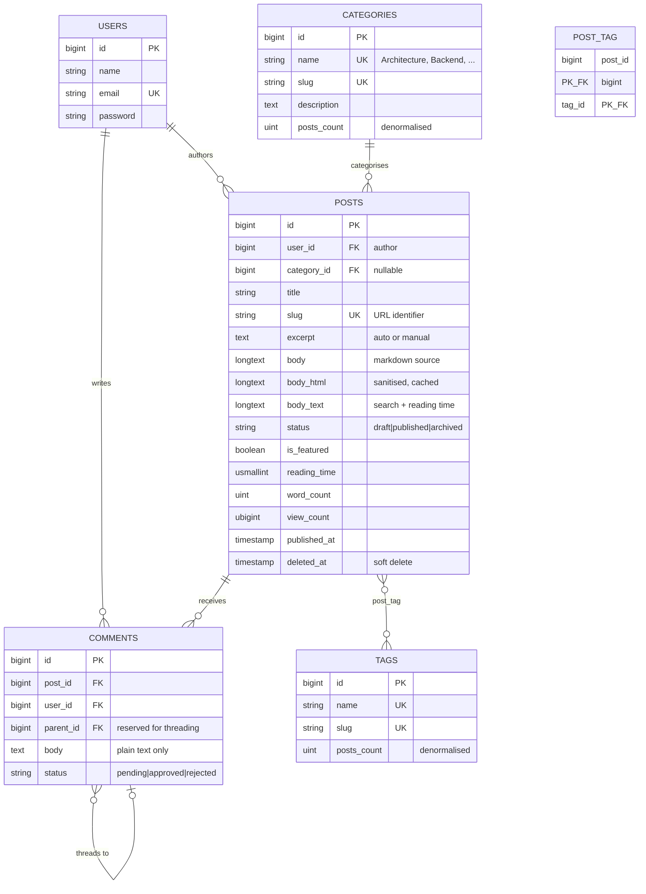
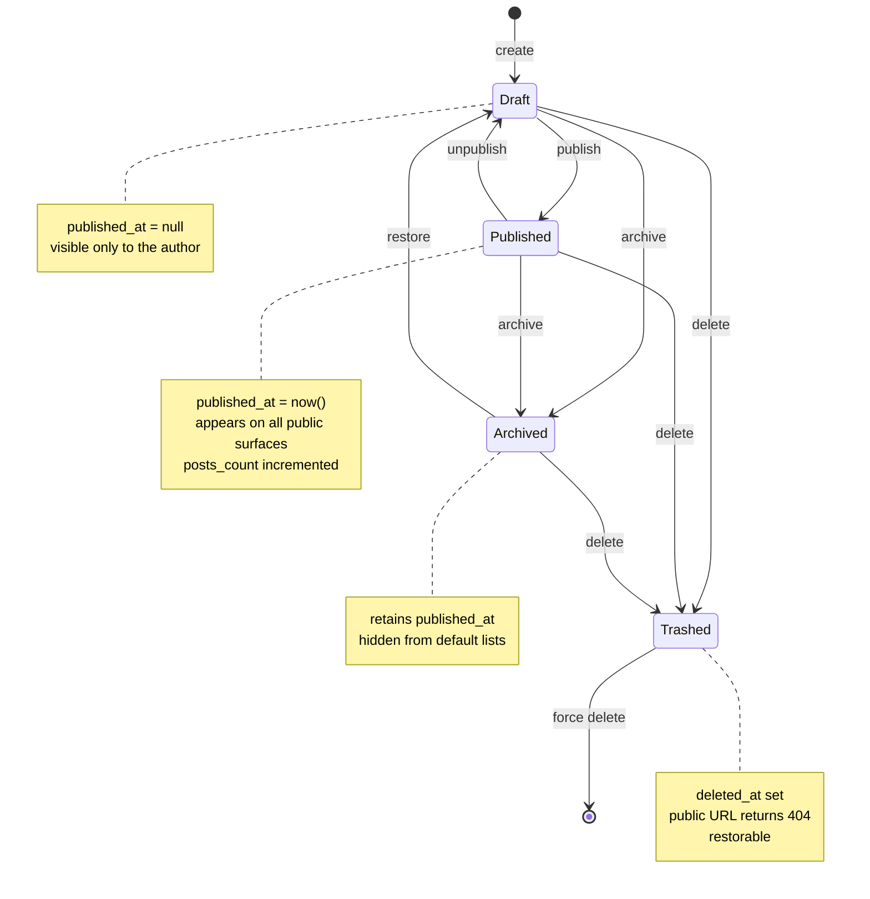
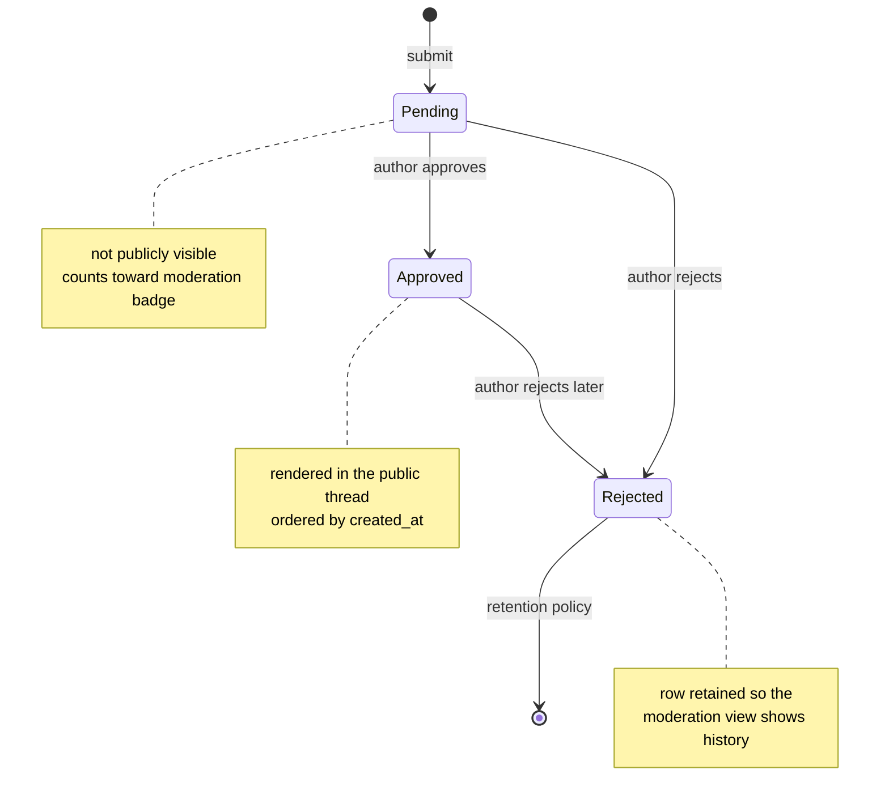
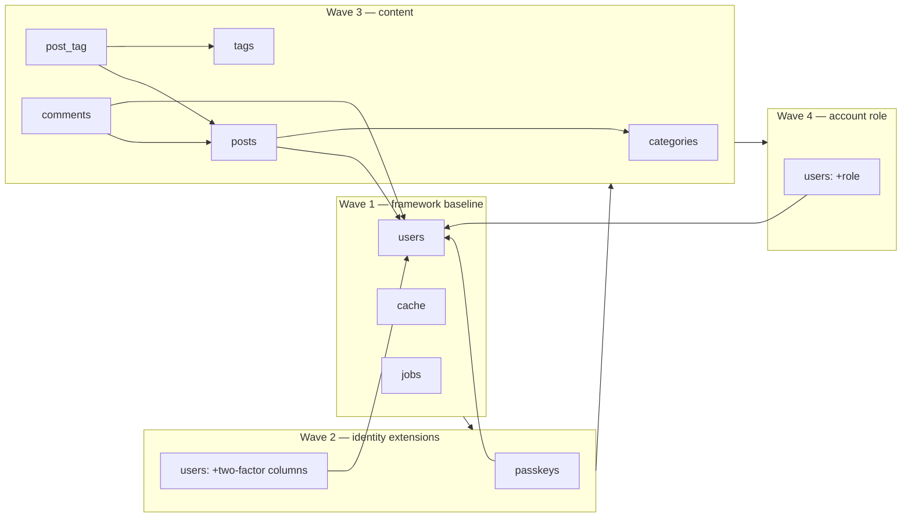
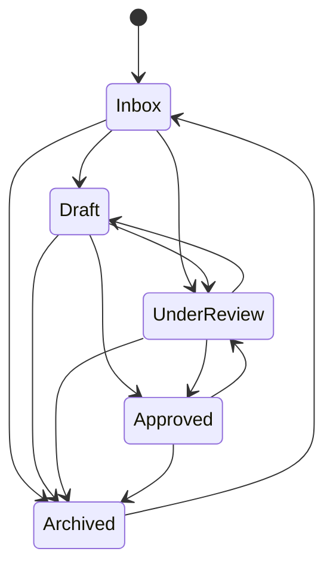
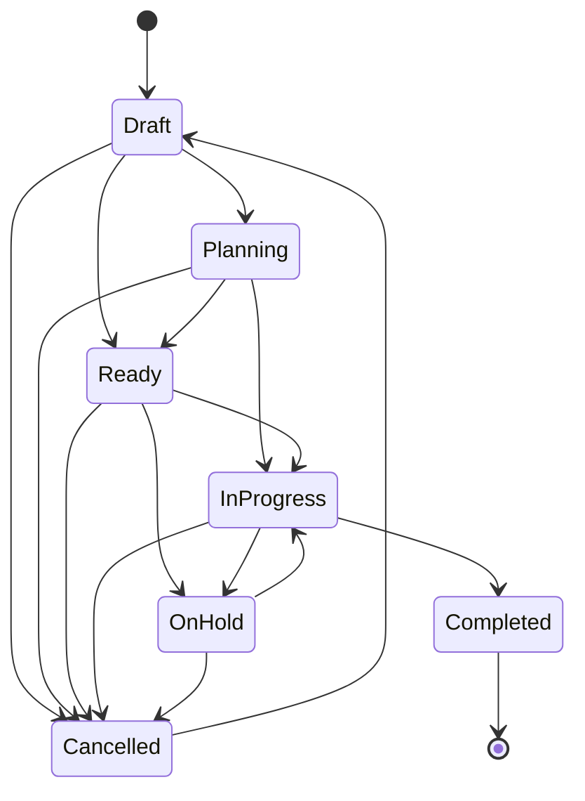

# Entity Relationship Diagram — DevFolio

Companion documents: [PRD](./PRD.md) · [TRD](./TRD.md) · [Application Flow](./APP-FLOW.md) · [UI/UX Brief](./UI-UX-BRIEF.md) · [Schema](./SCHEMA.md)

---

## 1. Diagram Conventions

| Notation | Meaning |
| --- | --- |
| `||--o{` | One-to-many, child optional |
| `||--|{` | One-to-many, at least one child |
| `}o--||` | Many-to-one, parent required |
| `}o--o|` | Many-to-one, parent optional |
| `}o--o{` | Many-to-many via pivot |
| `PK` | Primary key |
| `FK` | Foreign key |
| `U` | Unique index |
| `I` | Non-unique index |
| `S` | Soft-delete column |

A note on what this ERD deliberately does **not** draw: there is no `roles` table and no `permissions` table. Roles and permissions are enum-backed behaviour, not rows, and §5.9 argues that decision at length. An ERD that omitted them would look incomplete; one that drew them would be wrong. The `USERS` entity carries `role` as an indexed column, and that is the whole of the persistence.

---

## 2. The Core Diagram

Six entities: the account, the published word, and the taxonomy and threading
around it. This is **not the whole application**. The default connection holds 43
tables, 35 of which belong to this application rather than to Laravel's own cache,
queue, session and bookkeeping tables, and one picture of all 35 would be
unreadable. Each model is therefore drawn in its own section:

| Entities | Section |
| --- | --- |
| `users`, `posts`, `categories`, `tags`, `comments`, `passkeys` | §2 (here), isolated for review in §3 |
| Ideas, Plans, Tasks, the Developer Lab's three tables, and the platform taxonomy's three | §11 |
| `feed_posts`, `feed_attachments`, `communities`, `community_memberships` | **not drawn** — see §2.1 |
| `marketplace_*` (4), `ai_*` (8), `about_*` (2), `post_tag` | **not drawn** — see §2.1 |
| the framework baseline | §9 |

### 2.1 What this document does not model, and what that costs

Nineteen of the 35 application tables have no entity box anywhere in this file.
That is a gap, not a decision, and it is recorded here rather than papered over by
the heading:

- **The feed corpus** (`feed_posts`, `feed_attachments`, `communities`,
  `community_memberships`). `feed_posts` is the one omission worth naming, because
  it carries a *dual identity* no other table has: an `author` string that is
  corpus text rendered verbatim, and a nullable `user_id` that is the enforcement
  point. A stranger's byline cannot be made to look like a member's row, and a
  member who leaves does not take their posts with them. `community_memberships`
  is a real model rather than a pivot, and `communities` counts members through
  `withCount`, so there is no counter column to drift. All of it is documented in
  [`SCHEMA.md`](./SCHEMA.md) §2.6, §2.7, §3.6, §3.7 and §4.7.
- **The Marketplace** (`marketplace_categories`, `marketplace_products`,
  `marketplace_product_versions`, `marketplace_reviews`). Versions belong to a
  product, reviews belong to a product *and* a reviewer, and a seller owns the
  product. [`SCHEMA.md`](./SCHEMA.md) and
  [`ARCHITECTURE.md`](./ARCHITECTURE.md) carry that shape.
- **The AI Hub** (`ai_topics` with a self-referencing parent, `ai_articles`,
  `ai_article_topics` and `ai_article_related` as pivots, `ai_article_links`,
  `ai_learning_paths` and `ai_learning_path_items`, `ai_resources`). The hub is the
  densest subgraph in the application — eight tables — and it has no diagram.
- **About** (`about_sections`, `about_items`): one pair behind the public About
  page, `about_items` ordered within its section.
- **`post_tag`**, the one table drawn as an edge (`POSTS }o--o{ TAGS`) but given no
  entity box. It is a pure pivot with two timestamps, and §5.2 explains why it is
  keyed on the pair rather than on an id.

Every one of those relationships is enforced by a real foreign key in a migration;
none of this is a missing constraint, it is a missing picture. Drawing them is a
documentation task, and §4's catalogue is the cheapest place to start because the
rows are the same shape as R1–R14.

```mermaid
erDiagram
    USERS ||--o{ POSTS : "authors"
    USERS ||--o{ COMMENTS : "writes"
    USERS ||--o{ PASSKEYS : "registers"

    CATEGORIES ||--o{ POSTS : "groups"

    POSTS ||--o{ COMMENTS : "receives"
    POSTS }o--o{ TAGS : "labelled by"

    COMMENTS }o--o| COMMENTS : "replies to"

    USERS {
        bigint      id                  PK
        string      name
        string      email               U
        string      handle              U   "nullable, unique where present (SCHEMA.md §1.4)"
        timestamp   email_verified_at
        string      password
        string(20)  role                I   "account role: user | seller | admin"
        string      two_factor_secret
        string      two_factor_recovery_codes
        timestamp   two_factor_confirmed_at
        string      remember_token
        timestamp   created_at
        timestamp   updated_at
    }

    CATEGORIES {
        bigint      id                  PK
        string      name                U
        string      slug                U
        text        description
        string      color
        uint        posts_count
        timestamp   created_at
        timestamp   updated_at
    }

    TAGS {
        bigint      id                  PK
        string      name                U
        string      slug                U
        uint        posts_count
        timestamp   created_at
        timestamp   updated_at
    }

    POSTS {
        bigint      id                  PK
        bigint      user_id             FK
        bigint      category_id         FK
        string      title
        string      slug                U
        text        excerpt
        longtext    body
        longtext    body_html
        longtext    body_text
        string      status
        boolean     is_featured
        usmallint   reading_time
        uint        word_count
        ubigint     view_count
        timestamp   published_at
        timestamp   created_at
        timestamp   updated_at
        timestamp   deleted_at          S
    }

    POST_TAG {
        bigint      post_id             PK_FK
        bigint      tag_id              PK_FK
    }

    COMMENTS {
        bigint      id                  PK
        bigint      post_id             FK
        bigint      user_id             FK
        bigint      parent_id           FK
        text        body
        string      status
        timestamp   created_at
        timestamp   updated_at
    }

    PASSKEYS {
        bigint      id                  PK
        bigint      user_id             FK
        string      name
        string      credential_id       U
        text        public_key
        uint        counter
        timestamp   created_at
        timestamp   updated_at
    }
```

---

## 3. Core Content Model (Isolated View)

The starter-kit tables are present but peripheral to the product. This is the content subgraph alone — the part a reviewer needs to understand DevFolio's data model.



---

## 4. Relationship Catalogue

| # | Relationship | Cardinality | FK behaviour | Business rule |
| --- | --- | --- | --- | --- |
| R1 | `User` → `Post` | 1 : N | `cascadeOnDelete` | A post always has exactly one author. Deleting the author removes their posts. |
| R2 | `Category` → `Post` | 1 : N (nullable) | `nullOnDelete` | A post has at most one category. Deleting a category **never** deletes its posts; they become uncategorised. |
| R3 | `Post` ↔ `Tag` | N : M | `cascadeOnDelete` both sides | A post has any number of tags; a tag applies to any number of posts. Unlinking is the only meaningful delete. |
| R4 | `Post` → `Comment` | 1 : N | `cascadeOnDelete` | Comments belong to exactly one post and never outlive it. |
| R5 | `User` → `Comment` | 1 : N | `cascadeOnDelete` | Every comment has a named, authenticated author. No anonymous comments exist. |
| R6 | `Comment` → `Comment` | 1 : N (self, nullable) | `cascadeOnDelete` | Reserved for threading. v1 renders flat; the column ships now so threading is not a migration later. |
| R7 | `User` → `Passkey` | 1 : N | `cascadeOnDelete` | WebAuthn credentials. |
| R8 | `User` → `Idea` | 1 : N | `cascadeOnDelete` | Every idea has an author account. See §11 for the module subgraph. |
| R9 | `IdeaCategory` → `Idea` | 1 : N (nullable) | `nullOnDelete` | A folder is metadata; deleting one never deletes what was filed in it. Unique slug **per account**, not global. |
| R10 | `Idea` → `IdeaPlan` | 1 : 1 (nullable) | `nullOnDelete` | The plan remembers the idea it came from. The link is unique, so one idea yields at most one plan; it is nullable, so a plan written from scratch and a plan whose idea was deleted both exist. |
| R11 | `IdeaPlan` → `IdeaTask` | 1 : N | `cascadeOnDelete` | `plan_id` is `NOT NULL` and there is no `user_id` on a task — ownership derives from the plan. |
| R12 | `User` → `LabWorkspace` | 1 : N | `cascadeOnDelete` | The sandbox's saved panes. Bound by `id`; never public. |
| R13 | `User` → `LabSnippet` | 1 : N | `cascadeOnDelete` | A saved piece of code, publishable. |
| R14 | `User` → `LabExecution` | 1 : N | `cascadeOnDelete` | Append-only run log. Carries `language` and `label` denormalised, so it references no module row at all. |
| R15 | `Topic` ↔ `Idea` | N : M | `cascadeOnDelete` both sides | The platform's public subject list. At most 8 per idea, in the author's order, enforced by `Topic::syncRows()` because no database constraint can count. |
| R16 | `Topic` ↔ `LabSnippet` | N : M | `cascadeOnDelete` both sides | The same subjects, the same pivot shape. One `topics` table serves both modules; `idea_categories` stays private and `ai_topics` stays the hub's own tree. |

---

## 5. Key Modelling Decisions

### 5.1 Category is one-to-many, not many-to-many

**Decision.** A post has exactly one `category_id`.

**Why.** A reader browsing by category expects a partition, not overlapping buckets. If a post could be in "Backend" and "Architecture" simultaneously, the category counts would double-count and a category page would no longer be able to claim "N posts in Backend" truthfully. Multi-topic labelling is precisely what tags are for, and the model already has tags.

**Consequence.** A post that genuinely spans two topics gets the primary category plus tags for the secondary topic. This is a deliberate editorial constraint, and it produces better category pages.

### 5.2 Tags are many-to-many via a natural-keyed pivot

**Decision.** `post_tag` has no surrogate `id`; the composite `(post_id, tag_id)` is the primary key.

**Why.** The row expresses a fact, not an entity. A surrogate key would permit the same fact to be recorded twice unless a separate unique index were added — which is exactly the composite key. The natural key is both simpler and stricter.

### 5.3 Comments reference a user, never a free-text identity

**Decision.** `comments.user_id` is `NOT NULL`.

**Why.** Anonymous comment fields invite spam and produce an unverifiable "author" that the moderation UI cannot hold to account. Requiring authentication makes every comment attributable, gives the moderation queue a real identity to evaluate, and means the comment render path never needs a "what if there is no author" branch.

### 5.4 Three body representations on one row

**Decision.** `body` (markdown), `body_html` (sanitised render), `body_text` (plain projection) live on `posts`.

**Why.** Each serves a different caller with incompatible requirements: the editor needs lossless source, the public page needs pre-rendered safe HTML, and search needs a plain projection. Computing any of them on read either wastes CPU on the hot path or puts the sanitiser in the request pipeline. All three are written by one Action inside one transaction, so they cannot drift.

**Rejected alternative.** A separate `post_contents` table. It would add a join to every read for no benefit, since the three columns are always read together or written together, never independently.

### 5.5 Denormalised `posts_count` on taxonomy tables

**Decision.** `categories.posts_count` and `tags.posts_count` are stored, not computed.

**Why.** The blog index renders a count beside every category and tag on every request. That is 30 aggregate subqueries per render for values that change only on publish, unpublish, or delete. Storing them costs one increment inside an existing transaction.

**Consistency guarantee.** Maintained only by the publish/unpublish/delete Actions. A `posts:recount` Artisan command reconciles drift and is the recovery path if a future code path forgets to update them.

**Where the pattern stops.** `topics` carries no count column at all, and that is not an oversight. A subject may be advertised only on the strength of how many *published* rows carry it, so a stored counter would have to be incremented and decremented on both the publication path and the delete path, and any miss would advertise a subject that opens nothing — the exact failure §5.11 exists to prevent. The read is one `withCount` over a scoped pivot, and `PublicTaxonomy` memoises it for the request, so the cost is paid once per page either way.

### 5.6 `view_count` on the post row, not a views table

**Decision.** A single incrementing column.

**Why.** The product needs a number, not an analytics engine ([PRD §2.2](./PRD.md) excludes analytics beyond content metrics). A `post_views` table would grow to millions of rows to answer one `SUM`. If per-day view history is ever required, the correct change is a separate aggregate table written by a scheduled job, leaving `view_count` as the fast total.

### 5.7 Soft delete on posts only

**Decision.** `deleted_at` on `posts`. Nothing else.

**Why.** A post's URL may be linked from anywhere on the internet; deletion must be recoverable, and a soft-deleted post correctly 404s while remaining restorable. Comments, tags, categories, and pivots have no such external contract, so soft-deleting them would add a `deleted_at` predicate to every query for zero benefit. (The starter-kit `teams` table, the only other table that carried `deleted_at`, was removed with the team feature.)

### 5.8 Status as a string column with a PHP enum cast

**Decision.** `varchar(20)` columns, not native database enums and not integer constants.

**Why.** Native enums require an `ALTER TYPE` (PostgreSQL) or a table rebuild (SQLite/MySQL) to add a value, which is a migration risk for a change that should be a one-line enum edit. Integer constants are unreadable in a database client. A string column with a PHP enum cast gives type safety in application code, human-readable rows in the database, and a trivial path to adding `PostStatus::Scheduled` later.

The same reasoning applies to `users.role`, which is a `string(20)` with an
`AccountRole` cast.

---

### 5.9 Permissions are derived, so they have no entity

**Decision.** There is no `permissions` table, no `role_permissions` pivot and
no `roles` table. A `permissions` entity is the obvious thing to draw on an ERD,
and it is deliberately absent.

**Why.** The role → permission mapping is **behavioural**, not data. A
`role_permissions` table would let a deployment grant `post:publish` to `user`
through a database write, and the application — whose `PostPolicy`, sidebar and
route guards all read `AccountRole::permissions()` — would not notice. The guard
and the grant would disagree, and the disagreement would be silent.

Modelling permissions in code makes that unrepresentable: changing what a role
may do is a one-method edit that the type checker and the test suite both see.
See [`PERMISSIONS.md`](PERMISSIONS.md).

**The same decision applies to `RolePlan`.** Plans are commercial entitlements,
not authorization, and they live in code for the same reason.

---

### 5.10 Exactly one role enum

There is a single role column and a single role enum.

| Column | Values | Scope |
| --- | --- | --- |
| `users.role` | `user` \| `seller` \| `admin` | Platform-wide |

`AccountRole` is the **only** role axis in the application. An earlier
starter-kit design carried a second, team-scoped role on a `memberships` table
(`owner` \| `admin` \| `member`), resolved from a separate `TeamRole` enum. Both
the `memberships` table and the `TeamRole` enum were removed along with the team
feature: the persistence that remains is `users.role`, and the authorisation
that remains is `AccountRole` + `AccountPermission`.

**Why one axis is enough.** The two-axis model existed to answer "what may this
person do in *this* team" separately from "what may this person do on the
platform". With teams gone there is no narrower scope to express, so the
distinction has no referent — and a single axis cannot fall out of sync with
itself. An `admin` is an admin everywhere; there is no per-team privilege to
leak across a boundary, because there is no boundary.

In code the consequence is that a role is never ambiguous: `users.role` is
always an `AccountRole`, and no other enum competes for the name.

---

### 5.11 One shared subject list, not one per module

**Decision.** `topics` is a single platform-owned table with two pivots
(`idea_topic`, `lab_snippet_topic`), rather than an `idea_topics`/`lab_topics`
pair.

**Why.** A subject is what a row is *about*, and "accessibility" means the same
thing to an idea as it does to a snippet. Two parent tables would be two names
for one concept, two seeders to keep in step, and two slug spaces free to
disagree — a reader arriving at a subject link would need to know which module
owns the word before knowing what it meant. One table is also one count gate:
`PublicTaxonomy::topicChips($family)` takes the family as a parameter, so the
Ideas facet, the gallery facet, `/topics` and the structured-data keywords all
read the same rule instead of four near-copies of it.

**Rejected alternative.** The per-module pair. It was the first design, and it
saves nothing: the pivot is the module-specific part, and the pivot is already
per-module.

**Two neighbouring shapes it deliberately does not copy.** `idea_categories` is
per-account private filing and must stay invisible to strangers, which is why it
has `unique(user_id, slug)` and `topics` has a global unique slug. `ai_topics` is
the hub's one-level hierarchy (`parent_id`, `rootLevel()`, `hasChildren()`) and
is owned by that hub alone; `topics` is flat, because a subject that needs a
parent is two subjects. The shape reused is `posts` / `tags` / `post_tag`: a
natural-keyed pivot, both sides cascading.

**Consequence for the schema.** No column anywhere in these three tables stores
visibility. Publication lives on the idea and the snippet, so whether a subject
is public is derived per request from the rows that carry it — which is what the
edges above are drawn for, and what §11.1's third paragraph argues.

---

## 6. State Machine — Post Lifecycle

The status column is the state; the diagram shows which transitions exist and what each does to `published_at`.



**Public visibility predicate.** `status === 'published' AND published_at IS NOT NULL AND deleted_at IS NULL`. Every public query applies all three; no caller reimplements the check.

---

## 7. State Machine — Comment Lifecycle



---

## 8. Access Pattern Matrix

Which entity relationships each surface touches, and therefore which needs eager loading.

| Surface | Reads | Eager load required | Cardinality of result |
| --- | --- | --- | --- |
| Home | Posts (featured, latest), Categories | `category`, `tags` | ~9 posts |
| Blog index | Posts (filtered, paginated), Categories, Tags | `category`, `tags` | 9 posts + taxonomy |
| Blog detail | Post, Category, Tags, Comments, User, Related | `category`, `tags`, `approvedComments.user` | 1 post + N comments |
| About | User (author profile) | — | 1 |
| Dashboard | Posts (author's), Comments (pending), aggregates | `category` for the recent table | ~10 posts |
| Post editor | Post, Categories, Tags | `category`, `tags` | 1 post + taxonomy |
| Post list (author) | Posts (author's, filtered) | `category` | 15 posts |
| Moderation queue | Comments (pending, approved) | `user`, `post` | 20 comments |

**Rule.** Every row in this table with a non-empty "Eager load required" cell is a place where a missing `with()` produces an N+1. Each is covered by a test that asserts the query count, so a regression fails the suite rather than quietly costing 19 extra queries per page view.

---

## 9. Migration Dependency Order

**Thirty-eight migrations** exist in `database/migrations/`, and
[`SCHEMA.md`](./SCHEMA.md) §7 lists every one of them in five batches with its
dependencies. What follows is the **first four waves** — the framework baseline,
the identity extensions, the content model and the account role — because those
are the four this diagram's six entities participate in, and the dependency logic
worth arguing about (`role` last, not first; the `080206` gap; pivot tables after
both parents) is entirely in this range.

Waves 5 through 9 add the marketplace, community, About, AI Hub, feed-publishing
and module tables. They are additive, they reference only tables already present,
and none of them changes the reasoning below.



| Wave | Migration | Creates / alters | Depends on |
| --- | --- | --- | --- |
| 1 | `0001_01_01_000000_create_users_table` | `users`, `password_reset_tokens`, `sessions` | — |
| 1 | `0001_01_01_000001_create_cache_table` | `cache`, `cache_locks` | — |
| 1 | `0001_01_01_000002_create_jobs_table` | `jobs`, `job_batches`, `failed_jobs` | — |
| 2 | `2024_01_01_000000_create_passkeys_table` | `passkeys` | `users` |
| 2 | `2025_08_14_170933_add_two_factor_columns_to_users_table` | `users.two_factor_secret`, `two_factor_recovery_codes`, `two_factor_confirmed_at` | `users` |
| 3 | `2026_10_12_080202_create_categories_table` | `categories` | — |
| 3 | `2026_10_12_080203_create_tags_table` | `tags` | — |
| 3 | `2026_10_12_080204_create_posts_table` | `posts` (+ index `status, published_at`) | `users`, `categories` |
| 3 | `2026_10_12_080205_create_post_tag_table` | `post_tag` | `posts`, `tags` |
| 3 | `2026_10_12_080207_create_comments_table` | `comments` (+ index `post_id, status`) | `posts`, `users` |
| 4 | `2026_10_12_094528_add_role_to_users_table` | `users.role` (+ index `role`) | `users` |

### Why `role` is last and not first

Adding `role` inside `0001_01_01_000000_create_users_table` would have been tidier, and it is the wrong call. The framework baseline migration is the one file every future Laravel upgrade expects to find untouched; the `users` table is also the highest-traffic table to alter under load. Keeping `role` in its own later migration means:

- **The baseline stays stock.** Diffing against a fresh `laravel/laravel` skeleton still shows a clean `users` migration.
- **The column default carries the policy.** `role` is `NOT NULL` with `default('user')`, so a row inserted by *any* path — registration, seeder, factory, artisan tinker, a raw import — is born least-privileged. Elevation is always an explicit act. See §5.9 for why the enum value and the policy are the same decision.
- **It is reversible in isolation.** `down()` drops the index then the column and touches nothing else.

### Ordering constraints worth naming

- `post_tag` must come after both `posts` and `tags`; it is a pure pivot and has no other columns beyond the two timestamps.
- `comments` must come after `posts` — and after `users`, because the `user_id` foreign key is `cascadeOnDelete`, so deleting an account removes their comments even on other people's posts (§10).
- Wave 3 timestamps are milliseconds apart (`080202` … `080207`): the gap at `080206` is a migration that was authored and dropped during development. Left as-is rather than renumbered, because renaming an applied migration breaks `migrations` table bookkeeping on any database that has already run it.

---

## 10. Referential Integrity Summary

| Delete this | Effect on `posts` | Effect on `post_tag` | Effect on `comments` |
| --- | --- | --- | --- |
| A `user` | Their posts cascade-delete | Pivot rows cascade | Their comments and others' comments on those posts cascade |
| A `category` | Posts survive, `category_id → NULL` | Unaffected | Unaffected |
| A `tag` | Unaffected | Pivot rows cascade | Unaffected |
| A `post` (soft) | `deleted_at` set, row survives | Unaffected | Unaffected; queries hide them because the post is filtered out |
| A `post` (force) | Row gone | Pivot rows cascade | Comments cascade |
| A `comment` | Unaffected | Unaffected | Hard delete; replies cascade if threading is in use |

The category row is the one to read twice: **deleting a category never deletes content**. That is the single most consequential integrity decision in this model, and it is the reason the delete-category confirmation modal states the consequence explicitly.

---

## 11. Ideas and Developer Lab Subgraph

Seven module tables that hang off `users` and form one chain of their own, plus
the three-table platform taxonomy that Ideas and the Lab both attach to. They are
drawn apart from §2 for the same reason the content model is drawn apart in §3:
a reviewer reading the blog model should not have to skip past a task board, and
neither subgraph explains the other.

```mermaid
erDiagram
    USERS ||--o{ IDEAS : "captures"
    USERS ||--o{ IDEA_PLANS : "plans"
    USERS ||--o{ IDEA_CATEGORIES : "files into"
    USERS ||--o{ LAB_WORKSPACES : "saves"
    USERS ||--o{ LAB_SNIPPETS : "keeps"
    USERS ||--o{ LAB_EXECUTIONS : "runs"

    IDEA_CATEGORIES ||--o{ IDEAS : "groups"
    IDEAS ||--o| IDEA_PLANS : "becomes"
    IDEA_PLANS ||--|{ IDEA_TASKS : "decomposes into"

    TOPICS ||--o{ IDEA_TOPIC : "files"
    IDEAS ||--o{ IDEA_TOPIC : "carries"
    TOPICS ||--o{ LAB_SNIPPET_TOPIC : "files"
    LAB_SNIPPETS ||--o{ LAB_SNIPPET_TOPIC : "carries"

    IDEAS {
        bigint   id              PK
        bigint   user_id         FK
        bigint   idea_category_id FK  "nullable, nullOnDelete"
        string   title
        string   slug            U
        text     summary
        longtext content
        string   status          I  "inbox | draft | under_review | approved | archived"
        string   priority
        string   potential
        string   visibility
        boolean  is_pinned
        ubigint  view_count
        timestamp published_at
    }

    IDEA_CATEGORIES {
        bigint   id              PK
        bigint   user_id         FK
        string   name
        string   slug            U  "unique per user_id, not globally"
        text     description
    }

    IDEA_PLANS {
        bigint   id              PK
        bigint   user_id         FK
        bigint   idea_id         FK  "nullable, UNIQUE, nullOnDelete"
        string   title
        string   slug            U
        text     problem_statement
        text     proposed_solution
        text     scope
        text     out_of_scope
        text     goals
        longtext notes
        string   status
        string   priority
        string   estimated_effort
        date     target_start_date
        date     target_end_date
    }

    IDEA_TASKS {
        bigint   id              PK
        bigint   plan_id         FK  "NOT NULL, cascadeOnDelete"
        string   title
        text     description
        string   status
        string   priority
        date     due_date
        uint     sort_order
        timestamp completed_at
    }

    LAB_WORKSPACES {
        bigint   id              PK
        bigint   user_id         FK
        string   name
        longtext html
        longtext css
        longtext js
        timestamp last_run_at
    }

    LAB_SNIPPETS {
        bigint   id              PK
        bigint   user_id         FK
        string   language
        string   title
        string   slug            U
        longtext code
        text     description
        string   visibility
        ubigint  view_count
        timestamp published_at
    }

    LAB_EXECUTIONS {
        bigint   id              PK
        bigint   user_id         FK
        string   language
        string(160) label
        timestamp created_at
    }

    TOPICS {
        bigint   id              PK
        string   name
        string   slug            U  "global — /topics/{slug} is a public URL"
        text     description
        string(64) icon            "nullable, Flux icon name"
        usmallint sort_order       "tie-break after the published count"
        boolean  is_active         "retires a subject, pivots untouched"
    }

    IDEA_TOPIC {
        bigint   idea_id         PK FK "cascadeOnDelete"
        bigint   topic_id        PK FK "cascadeOnDelete"
        usmallint sort_order       "author order; 0 is the primary subject"
    }

    LAB_SNIPPET_TOPIC {
        bigint   lab_snippet_id  PK FK "cascadeOnDelete"
        bigint   topic_id        PK FK "cascadeOnDelete"
        usmallint sort_order       "author order; 0 is the primary subject"
    }
```

### 11.1 The three edges worth arguing about

**`IDEAS ||--o| IDEA_PLANS` is drawn as one-to-zero-or-one, and the database
agrees.** `idea_plans.idea_id` carries a **unique** index, so "one idea, at most
one plan" is a constraint rather than a convention the conversion action happens
to honour. It is nullable, which is what makes the reverse leg honest: a plan
written from scratch has no idea, and a plan whose idea was deleted keeps
standing with a null. Neither case is an anomaly the schema tolerates; both are
the reason the column is nullable in the first place.

**`IDEA_TASKS` has no `user_id` edge, and that omission is the design.**
Ownership reaches a task only through its plan (`}o--||`, not optional), so there
is no column on the task that could disagree with the plan it belongs to. A task
is born from a plan screen and every mutation re-asserts the parent's owner
before it writes. `plan_id` cascades rather than nulls because a task with no
plan is a fact about nothing.

**`TOPICS` has no `user_id` edge, and no `published` column, and both omissions
are the design.** Every other content entity in this subgraph hangs off an
account; a subject hangs off nobody, because it is the platform's vocabulary, not
somebody's filing — which is precisely what `idea_categories` is and what it must
remain. And because the edge `IDEAS ||--o{ IDEA_TOPIC` says nothing about
publication, the pivot cannot be read as a promise: a subject with a hundred
draft ideas behind it advertises nothing. The public read therefore always walks
the pivot *through* the row's `published()` scope, which is the rule
`PublicTaxonomy` owns and `PublicTaxonomyTest` pins. `is_active` is the operator's
switch and is orthogonal: switching a subject off leaves every pivot row alone, so
the author's filing survives and reappears when the subject returns.

### 11.2 State machines

Two of the three are enum-owned (`allowedTransitions()` on `IdeaStatus` and
`PlanStatus`), which means the workflow is readable without opening a controller,
and the form's status picker is generated from it rather than from a list of
strings someone typed twice.



`Archived → Inbox` is the only backward edge into a live state, and it exists
because an inbox is a holding area rather than a decision. `Approved` is the only
status eligible for publication, and `Approved → Draft` is **not** permitted:
approval is a conclusion, and reopening one means sending the idea back through
review rather than editing it quietly.



`Completed` is terminal with no outgoing edge. `Cancelled → Draft` is allowed
because a cancelled plan that gets picked up again is a fresh start on the same
document, not a continuation of a dead one.

Tasks do not have a state machine. `Todo → In progress → Done`, with `Blocked`
available from either open state, is a four-case enum and a `completed_at`
timestamp; drawing arrows between them would imply a rule the module does not
enforce, and an author re-ordering their own checklist is not a workflow
violation.

### 11.3 Referential integrity for the module tables

| Delete this | Effect on `ideas` | Effect on `idea_plans` | Effect on `idea_tasks` |
| --- | --- | --- | --- |
| A `user` | Their ideas cascade | Their plans cascade | Cascades through the plans |
| An `idea_category` | Ideas survive, `idea_category_id → NULL` | Unaffected | Unaffected |
| An `idea` | Row gone | The plan survives, `idea_id → NULL` | Unaffected |
| An `idea_plan` | Unaffected | Row gone | Tasks cascade |

| Delete this | Effect on `lab_workspaces` | Effect on `lab_snippets` | Effect on `lab_executions` |
| --- | --- | --- | --- |
| A `user` | Rows cascade | Rows cascade | Rows cascade |
| A `lab_workspace` | Row gone | Unaffected | History rows survive: nothing points back |
| A `lab_snippet` | Unaffected | Row gone | History rows survive, for the same reason |

The two survival rows are the point of the denormalised `language` and `label`
columns on `lab_executions`: the log does not reference a workspace or a snippet
at all, so deleting the source of a run never rewrites history and never leaves
a half-blank row behind.

| Delete this | Effect on `idea_topic` | Effect on `lab_snippet_topic` | Effect on `topics` |
| --- | --- | --- | --- |
| An `idea` | Its links cascade | Unaffected | Unaffected — a subject outlives the rows that used it |
| A `lab_snippet` | Unaffected | Its links cascade | Unaffected |
| A `topic` | The ideas survive, unlinked from it | The snippets survive, unlinked from it | Row gone |

The third row is the one to read twice: **deleting a subject never deletes
content**, for the same reason §10 states for a category. The cheaper lever is
`is_active`, which retires a subject while every pivot row stays in place, so the
author's filing survives and reappears when the subject returns. Note what does
*not* exist: there is no admin console for `topics` — the hub's console manages
`ai_topics` and nothing else — so both levers are currently exercised through the
database, and `TopicsSeeder` deliberately never writes `is_active` so a re-seed
cannot switch a retired subject back on.
