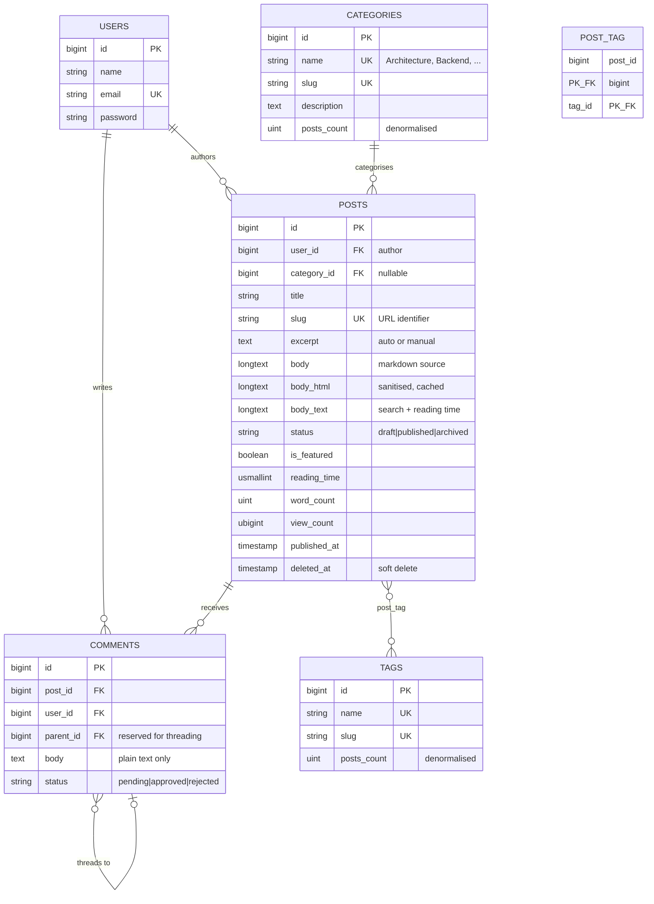
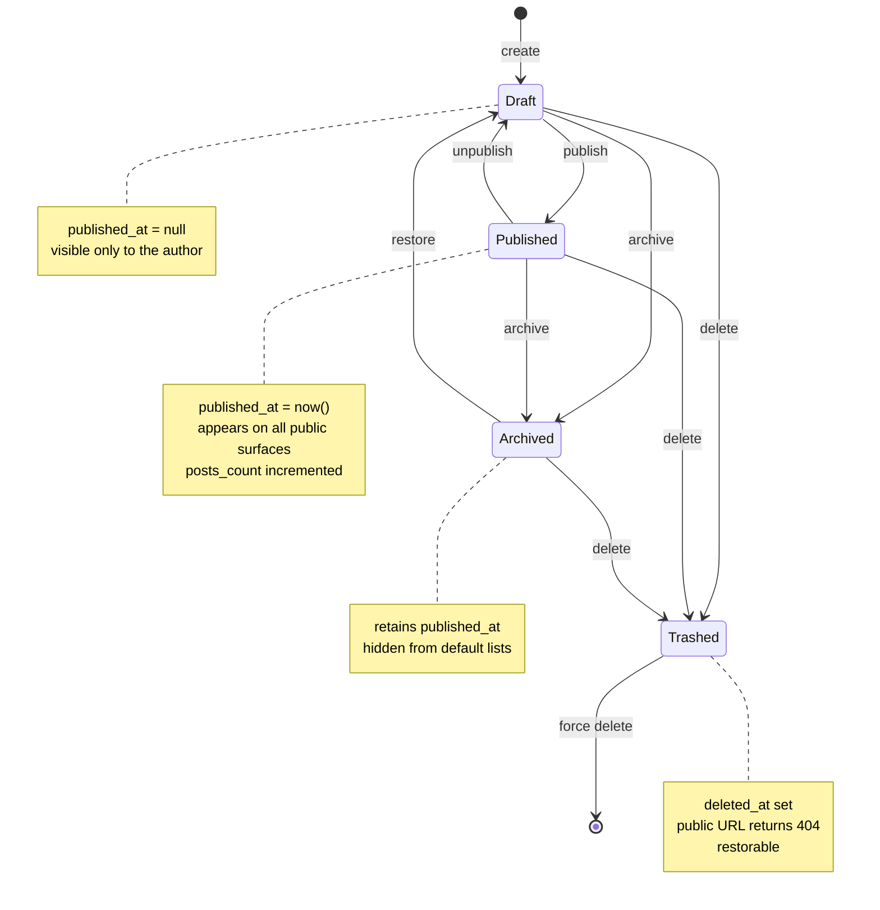
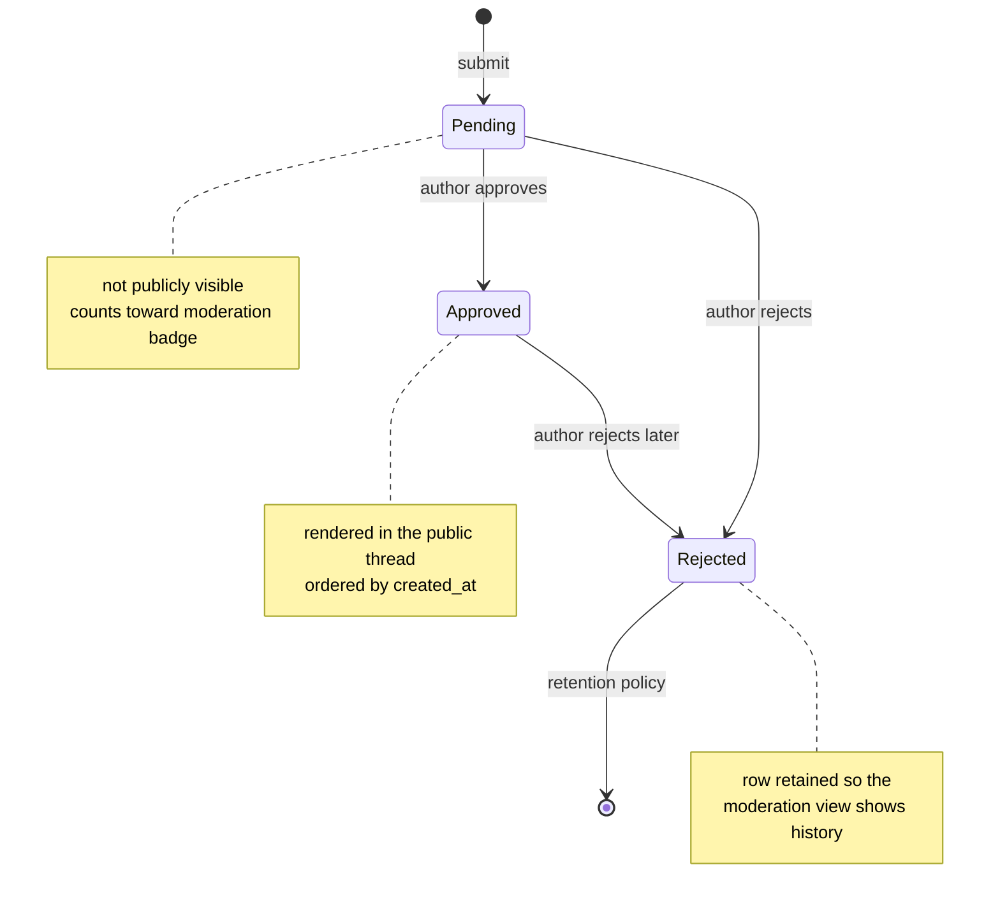
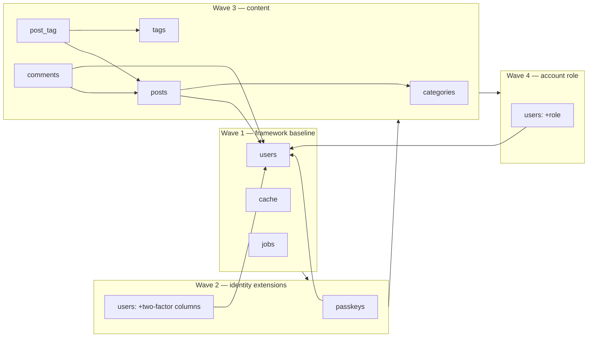

# Entity Relationship Diagram — DevFolio

Companion documents: [PRD](./PRD.md) · [TRD](./TRD.md) · [Application Flow](./APP-FLOW.md) · [UI/UX Brief](./UI-UX-BRIEF.md) · [Schema](./SCHEMA.md)

---

## 1. Diagram Conventions

| Notation | Meaning |
| --- | --- |
| `||--o{` | One-to-many, child optional |
| `||--|{` | One-to-many, at least one child |
| `}o--||` | Many-to-one, parent required |
| `}o--o|` | Many-to-one, parent optional |
| `}o--o{` | Many-to-many via pivot |
| `PK` | Primary key |
| `FK` | Foreign key |
| `U` | Unique index |
| `I` | Non-unique index |
| `S` | Soft-delete column |

A note on what this ERD deliberately does **not** draw: there is no `roles` table and no `permissions` table. Roles and permissions are enum-backed behaviour, not rows, and §5.9 argues that decision at length. An ERD that omitted them would look incomplete; one that drew them would be wrong. The `USERS` entity carries `role` as an indexed column, and that is the whole of the persistence.

---

## 2. Full Entity Relationship Diagram

```mermaid
erDiagram
    USERS ||--o{ POSTS : "authors"
    USERS ||--o{ COMMENTS : "writes"
    USERS ||--o{ PASSKEYS : "registers"

    CATEGORIES ||--o{ POSTS : "groups"

    POSTS ||--o{ COMMENTS : "receives"
    POSTS }o--o{ TAGS : "labelled by"

    COMMENTS }o--o| COMMENTS : "replies to"

    USERS {
        bigint      id                  PK
        string      name
        string      email               U
        timestamp   email_verified_at
        string      password
        string(20)  role                I   "account role: user | seller | admin"
        string      two_factor_secret
        string      two_factor_recovery_codes
        timestamp   two_factor_confirmed_at
        string      remember_token
        timestamp   created_at
        timestamp   updated_at
    }

    CATEGORIES {
        bigint      id                  PK
        string      name                U
        string      slug                U
        text        description
        string      color
        uint        posts_count
        timestamp   created_at
        timestamp   updated_at
    }

    TAGS {
        bigint      id                  PK
        string      name                U
        string      slug                U
        uint        posts_count
        timestamp   created_at
        timestamp   updated_at
    }

    POSTS {
        bigint      id                  PK
        bigint      user_id             FK
        bigint      category_id         FK
        string      title
        string      slug                U
        text        excerpt
        longtext    body
        longtext    body_html
        longtext    body_text
        string      status
        boolean     is_featured
        usmallint   reading_time
        uint        word_count
        ubigint     view_count
        timestamp   published_at
        timestamp   created_at
        timestamp   updated_at
        timestamp   deleted_at          S
    }

    POST_TAG {
        bigint      post_id             PK_FK
        bigint      tag_id              PK_FK
    }

    COMMENTS {
        bigint      id                  PK
        bigint      post_id             FK
        bigint      user_id             FK
        bigint      parent_id           FK
        text        body
        string      status
        timestamp   created_at
        timestamp   updated_at
    }

    PASSKEYS {
        bigint      id                  PK
        bigint      user_id             FK
        string      name
        string      credential_id       U
        text        public_key
        uint        counter
        timestamp   created_at
        timestamp   updated_at
    }
```

---

## 3. Core Content Model (Isolated View)

The starter-kit tables are present but peripheral to the product. This is the content subgraph alone — the part a reviewer needs to understand DevFolio's data model.



---

## 4. Relationship Catalogue

| # | Relationship | Cardinality | FK behaviour | Business rule |
| --- | --- | --- | --- | --- |
| R1 | `User` → `Post` | 1 : N | `cascadeOnDelete` | A post always has exactly one author. Deleting the author removes their posts. |
| R2 | `Category` → `Post` | 1 : N (nullable) | `nullOnDelete` | A post has at most one category. Deleting a category **never** deletes its posts; they become uncategorised. |
| R3 | `Post` ↔ `Tag` | N : M | `cascadeOnDelete` both sides | A post has any number of tags; a tag applies to any number of posts. Unlinking is the only meaningful delete. |
| R4 | `Post` → `Comment` | 1 : N | `cascadeOnDelete` | Comments belong to exactly one post and never outlive it. |
| R5 | `User` → `Comment` | 1 : N | `cascadeOnDelete` | Every comment has a named, authenticated author. No anonymous comments exist. |
| R6 | `Comment` → `Comment` | 1 : N (self, nullable) | `cascadeOnDelete` | Reserved for threading. v1 renders flat; the column ships now so threading is not a migration later. |
| R7 | `User` → `Passkey` | 1 : N | `cascadeOnDelete` | WebAuthn credentials. |

---

## 5. Key Modelling Decisions

### 5.1 Category is one-to-many, not many-to-many

**Decision.** A post has exactly one `category_id`.

**Why.** A reader browsing by category expects a partition, not overlapping buckets. If a post could be in "Backend" and "Architecture" simultaneously, the category counts would double-count and a category page would no longer be able to claim "N posts in Backend" truthfully. Multi-topic labelling is precisely what tags are for, and the model already has tags.

**Consequence.** A post that genuinely spans two topics gets the primary category plus tags for the secondary topic. This is a deliberate editorial constraint, and it produces better category pages.

### 5.2 Tags are many-to-many via a natural-keyed pivot

**Decision.** `post_tag` has no surrogate `id`; the composite `(post_id, tag_id)` is the primary key.

**Why.** The row expresses a fact, not an entity. A surrogate key would permit the same fact to be recorded twice unless a separate unique index were added — which is exactly the composite key. The natural key is both simpler and stricter.

### 5.3 Comments reference a user, never a free-text identity

**Decision.** `comments.user_id` is `NOT NULL`.

**Why.** Anonymous comment fields invite spam and produce an unverifiable "author" that the moderation UI cannot hold to account. Requiring authentication makes every comment attributable, gives the moderation queue a real identity to evaluate, and means the comment render path never needs a "what if there is no author" branch.

### 5.4 Three body representations on one row

**Decision.** `body` (markdown), `body_html` (sanitised render), `body_text` (plain projection) live on `posts`.

**Why.** Each serves a different caller with incompatible requirements: the editor needs lossless source, the public page needs pre-rendered safe HTML, and search needs a plain projection. Computing any of them on read either wastes CPU on the hot path or puts the sanitiser in the request pipeline. All three are written by one Action inside one transaction, so they cannot drift.

**Rejected alternative.** A separate `post_contents` table. It would add a join to every read for no benefit, since the three columns are always read together or written together, never independently.

### 5.5 Denormalised `posts_count` on taxonomy tables

**Decision.** `categories.posts_count` and `tags.posts_count` are stored, not computed.

**Why.** The blog index renders a count beside every category and tag on every request. That is 30 aggregate subqueries per render for values that change only on publish, unpublish, or delete. Storing them costs one increment inside an existing transaction.

**Consistency guarantee.** Maintained only by the publish/unpublish/delete Actions. A `posts:recount` Artisan command reconciles drift and is the recovery path if a future code path forgets to update them.

### 5.6 `view_count` on the post row, not a views table

**Decision.** A single incrementing column.

**Why.** The product needs a number, not an analytics engine ([PRD §2.2](./PRD.md) excludes analytics beyond content metrics). A `post_views` table would grow to millions of rows to answer one `SUM`. If per-day view history is ever required, the correct change is a separate aggregate table written by a scheduled job, leaving `view_count` as the fast total.

### 5.7 Soft delete on posts only

**Decision.** `deleted_at` on `posts`. Nothing else.

**Why.** A post's URL may be linked from anywhere on the internet; deletion must be recoverable, and a soft-deleted post correctly 404s while remaining restorable. Comments, tags, categories, and pivots have no such external contract, so soft-deleting them would add a `deleted_at` predicate to every query for zero benefit. (The starter-kit `teams` table, the only other table that carried `deleted_at`, was removed with the team feature.)

### 5.8 Status as a string column with a PHP enum cast

**Decision.** `varchar(20)` columns, not native database enums and not integer constants.

**Why.** Native enums require an `ALTER TYPE` (PostgreSQL) or a table rebuild (SQLite/MySQL) to add a value, which is a migration risk for a change that should be a one-line enum edit. Integer constants are unreadable in a database client. A string column with a PHP enum cast gives type safety in application code, human-readable rows in the database, and a trivial path to adding `PostStatus::Scheduled` later.

The same reasoning applies to `users.role`, which is a `string(20)` with an
`AccountRole` cast.

---

### 5.9 Permissions are derived, so they have no entity

**Decision.** There is no `permissions` table, no `role_permissions` pivot and
no `roles` table. A `permissions` entity is the obvious thing to draw on an ERD,
and it is deliberately absent.

**Why.** The role → permission mapping is **behavioural**, not data. A
`role_permissions` table would let a deployment grant `post:publish` to `user`
through a database write, and the application — whose `PostPolicy`, sidebar and
route guards all read `AccountRole::permissions()` — would not notice. The guard
and the grant would disagree, and the disagreement would be silent.

Modelling permissions in code makes that unrepresentable: changing what a role
may do is a one-method edit that the type checker and the test suite both see.
See [`PERMISSIONS.md`](PERMISSIONS.md).

**The same decision applies to `RolePlan`.** Plans are commercial entitlements,
not authorization, and they live in code for the same reason.

---

### 5.10 Exactly one role enum

There is a single role column and a single role enum.

| Column | Values | Scope |
| --- | --- | --- |
| `users.role` | `user` \| `seller` \| `admin` | Platform-wide |

`AccountRole` is the **only** role axis in the application. An earlier
starter-kit design carried a second, team-scoped role on a `memberships` table
(`owner` \| `admin` \| `member`), resolved from a separate `TeamRole` enum. Both
the `memberships` table and the `TeamRole` enum were removed along with the team
feature: the persistence that remains is `users.role`, and the authorisation
that remains is `AccountRole` + `AccountPermission`.

**Why one axis is enough.** The two-axis model existed to answer "what may this
person do in *this* team" separately from "what may this person do on the
platform". With teams gone there is no narrower scope to express, so the
distinction has no referent — and a single axis cannot fall out of sync with
itself. An `admin` is an admin everywhere; there is no per-team privilege to
leak across a boundary, because there is no boundary.

In code the consequence is that a role is never ambiguous: `users.role` is
always an `AccountRole`, and no other enum competes for the name.

---

## 6. State Machine — Post Lifecycle

The status column is the state; the diagram shows which transitions exist and what each does to `published_at`.



**Public visibility predicate.** `status === 'published' AND published_at IS NOT NULL AND deleted_at IS NULL`. Every public query applies all three; no caller reimplements the check.

---

## 7. State Machine — Comment Lifecycle



---

## 8. Access Pattern Matrix

Which entity relationships each surface touches, and therefore which needs eager loading.

| Surface | Reads | Eager load required | Cardinality of result |
| --- | --- | --- | --- |
| Home | Posts (featured, latest), Categories | `category`, `tags` | ~9 posts |
| Blog index | Posts (filtered, paginated), Categories, Tags | `category`, `tags` | 9 posts + taxonomy |
| Blog detail | Post, Category, Tags, Comments, User, Related | `category`, `tags`, `approvedComments.user` | 1 post + N comments |
| About | User (author profile) | — | 1 |
| Dashboard | Posts (author's), Comments (pending), aggregates | `category` for the recent table | ~10 posts |
| Post editor | Post, Categories, Tags | `category`, `tags` | 1 post + taxonomy |
| Post list (author) | Posts (author's, filtered) | `category` | 15 posts |
| Moderation queue | Comments (pending, approved) | `user`, `post` | 20 comments |

**Rule.** Every row in this table with a non-empty "Eager load required" cell is a place where a missing `with()` produces an N+1. Each is covered by a test that asserts the query count, so a regression fails the suite rather than quietly costing 19 extra queries per page view.

---

## 9. Migration Dependency Order

Eleven migrations, in four waves. Arrows are hard dependencies: a table cannot be created before everything pointing at it exists. The filenames sort in exactly this order — that is not cosmetic, it is the execution order.



| Wave | Migration | Creates / alters | Depends on |
| --- | --- | --- | --- |
| 1 | `0001_01_01_000000_create_users_table` | `users`, `password_reset_tokens`, `sessions` | — |
| 1 | `0001_01_01_000001_create_cache_table` | `cache`, `cache_locks` | — |
| 1 | `0001_01_01_000002_create_jobs_table` | `jobs`, `job_batches`, `failed_jobs` | — |
| 2 | `2024_01_01_000000_create_passkeys_table` | `passkeys` | `users` |
| 2 | `2025_08_14_170933_add_two_factor_columns_to_users_table` | `users.two_factor_secret`, `two_factor_recovery_codes`, `two_factor_confirmed_at` | `users` |
| 3 | `2026_10_12_080202_create_categories_table` | `categories` | — |
| 3 | `2026_10_12_080203_create_tags_table` | `tags` | — |
| 3 | `2026_10_12_080204_create_posts_table` | `posts` (+ index `status, published_at`) | `users`, `categories` |
| 3 | `2026_10_12_080205_create_post_tag_table` | `post_tag` | `posts`, `tags` |
| 3 | `2026_10_12_080207_create_comments_table` | `comments` (+ index `post_id, status`) | `posts`, `users` |
| 4 | `2026_10_12_094528_add_role_to_users_table` | `users.role` (+ index `role`) | `users` |

### Why `role` is last and not first

Adding `role` inside `0001_01_01_000000_create_users_table` would have been tidier, and it is the wrong call. The framework baseline migration is the one file every future Laravel upgrade expects to find untouched; the `users` table is also the highest-traffic table to alter under load. Keeping `role` in its own later migration means:

- **The baseline stays stock.** Diffing against a fresh `laravel/laravel` skeleton still shows a clean `users` migration.
- **The column default carries the policy.** `role` is `NOT NULL` with `default('user')`, so a row inserted by *any* path — registration, seeder, factory, artisan tinker, a raw import — is born least-privileged. Elevation is always an explicit act. See §5.9 for why the enum value and the policy are the same decision.
- **It is reversible in isolation.** `down()` drops the index then the column and touches nothing else.

### Ordering constraints worth naming

- `post_tag` must come after both `posts` and `tags`; it is a pure pivot and has no other columns beyond the two timestamps.
- `comments` must come after `posts` — and after `users`, because the `user_id` foreign key is `cascadeOnDelete`, so deleting an account removes their comments even on other people's posts (§10).
- Wave 3 timestamps are milliseconds apart (`080202` … `080207`): the gap at `080206` is a migration that was authored and dropped during development. Left as-is rather than renumbered, because renaming an applied migration breaks `migrations` table bookkeeping on any database that has already run it.

---

## 10. Referential Integrity Summary

| Delete this | Effect on `posts` | Effect on `post_tag` | Effect on `comments` |
| --- | --- | --- | --- |
| A `user` | Their posts cascade-delete | Pivot rows cascade | Their comments and others' comments on those posts cascade |
| A `category` | Posts survive, `category_id → NULL` | Unaffected | Unaffected |
| A `tag` | Unaffected | Pivot rows cascade | Unaffected |
| A `post` (soft) | `deleted_at` set, row survives | Unaffected | Unaffected; queries hide them because the post is filtered out |
| A `post` (force) | Row gone | Pivot rows cascade | Comments cascade |
| A `comment` | Unaffected | Unaffected | Hard delete; replies cascade if threading is in use |

The category row is the one to read twice: **deleting a category never deletes content**. That is the single most consequential integrity decision in this model, and it is the reason the delete-category confirmation modal states the consequence explicitly.
